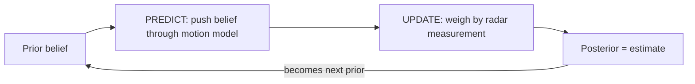
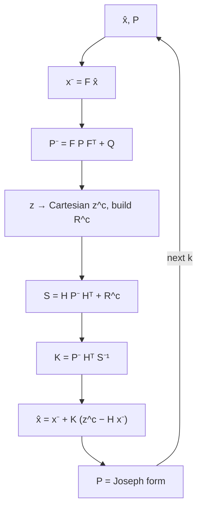
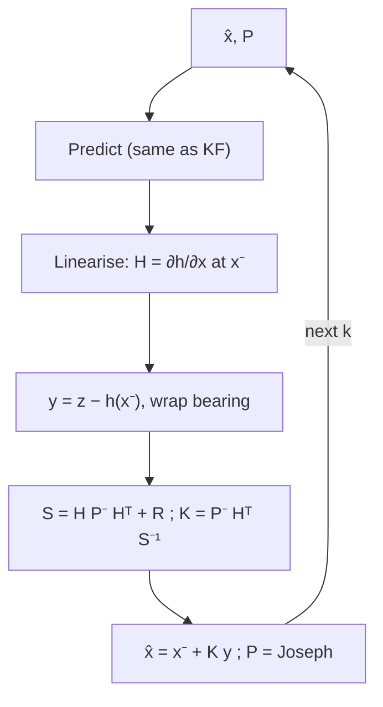
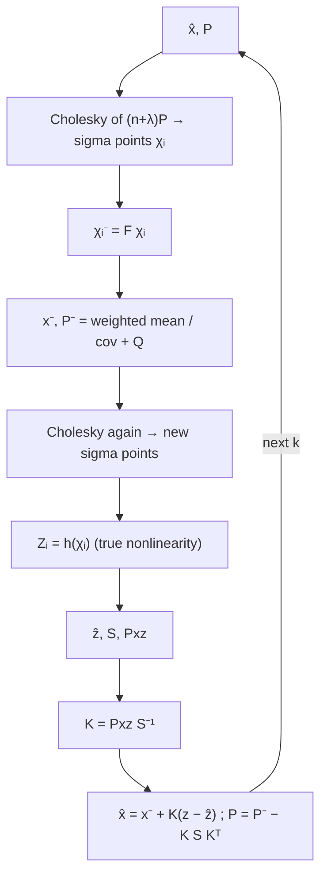
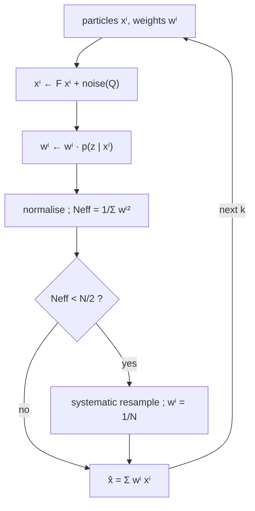
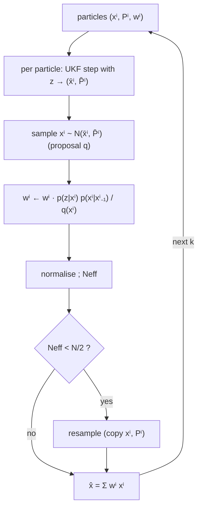
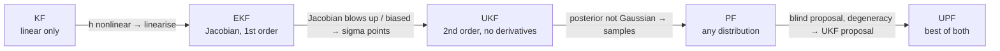

# Filters Lab — KF · EKF · UKF · PF · UPF

Five Bayesian state estimators, written from scratch in **Go** (no linear-algebra libraries), served to a **React** UI, with run history in **Postgres**.

```
./up      # build + start  → http://localhost:3000
./down    # stop
./clean   # stop + delete containers, volumes, images
```

The demo tracks a target flying past a **range–bearing radar** at the origin. The target curves (the filters assume straight-line motion), passes close to the radar, and the radar occasionally returns outliers. Every filter sees identical data. Sliders let you change noise, outliers, particle count — and one checkbox, **Break the math**, sets $R=Q=P_0=0$ to make the numerics fail on purpose.

| Layer | Where | Notes |
|---|---|---|
| Filters + matrix lib | `backend/filters.go`, `mat.go` | Gauss–Jordan inverse, Cholesky, regularised fallbacks |
| Simulation | `backend/sim.go` | truth, noisy radar, metrics |
| API | `backend/main.go` | `POST /api/run`, `GET /api/runs`, `GET /api/runs/{id}` |
| Postgres | table `runs` (JSONB) | history; app works without it |
| UI | `frontend/src/App.jsx` | canvas track + particle clouds, error chart, scoreboard |

---

## 0. Common model

State $\mathbf{x}_k=[p_x,\,p_y,\,v_x,\,v_y]^\top$.

$$\mathbf{x}_k = F\mathbf{x}_{k-1}+\mathbf{w}_k,\quad \mathbf{w}_k\sim\mathcal N(0,Q)$$
$$\mathbf{z}_k = h(\mathbf{x}_k)+\mathbf{v}_k,\quad h(\mathbf{x})=\begin{bmatrix}\sqrt{p_x^2+p_y^2}\\ \operatorname{atan2}(p_y,p_x)\end{bmatrix},\quad \mathbf{v}_k\sim\mathcal N(0,R),\ R=\mathrm{diag}(\sigma_r^2,\sigma_\theta^2)$$

Every filter approximates the same recursion:

$$p(\mathbf{x}_k|\mathbf{z}_{1:k}) \;\propto\; \underbrace{p(\mathbf{z}_k|\mathbf{x}_k)}_{\text{update}}\ \underbrace{\int p(\mathbf{x}_k|\mathbf{x}_{k-1})\,p(\mathbf{x}_{k-1}|\mathbf{z}_{1:k-1})\,d\mathbf{x}_{k-1}}_{\text{predict}}$$

They differ only in **how they approximate this integral and the product**.



---

## 1. Kalman filter (KF)

Exact for **linear + Gaussian** problems. The radar is nonlinear, so KF is fed *converted measurements* $\mathbf{z}^c=[r\cos\theta,\ r\sin\theta]$ with $H=[I_2\ 0]$ and the converted covariance

$$R^c=\begin{bmatrix}\sigma_r^2c^2+r^2\sigma_\theta^2s^2 & (\sigma_r^2-r^2\sigma_\theta^2)sc\\ \cdot & \sigma_r^2s^2+r^2\sigma_\theta^2c^2\end{bmatrix},\ c=\cos\theta,\ s=\sin\theta$$

**Predict**
$$\hat{\mathbf{x}}^-=F\hat{\mathbf{x}},\qquad P^-=FPF^\top+Q$$
**Update**
$$S=HP^-H^\top+R^c,\quad K=P^-H^\top S^{-1}$$
$$\hat{\mathbf{x}}=\hat{\mathbf{x}}^-+K(\mathbf{z}^c-H\hat{\mathbf{x}}^-),\quad P=(I-KH)P^-(I-KH)^\top+KR^cK^\top\ \text{(Joseph form)}$$



**Shortcoming:** only valid if $h$ is linear. Converting polar→Cartesian is a hack; the converted noise is no longer Gaussian when $\sigma_\theta r$ is large (banana-shaped uncertainty).

---

## 2. Extended Kalman filter (EKF)

**Fix for KF:** keep the *polar* measurement and **linearise** $h$ around the current estimate with the Jacobian:

$$H_k=\left.\frac{\partial h}{\partial\mathbf{x}}\right|_{\hat{\mathbf{x}}^-}=\begin{bmatrix}\frac{p_x}{r}&\frac{p_y}{r}&0&0\\[2pt]-\frac{p_y}{r^2}&\frac{p_x}{r^2}&0&0\end{bmatrix}$$

Predict as in KF. Update with innovation $\mathbf{y}=\mathbf{z}-h(\hat{\mathbf{x}}^-)$ (bearing wrapped to $(-\pi,\pi]$), then the same $S,K,P$ equations with $H_k$ and $R=\mathrm{diag}(\sigma_r^2,\sigma_\theta^2)$.



**Shortcomings** (visible when the target flies close to the radar):
* $r\to0\Rightarrow H\to\infty$: the Jacobian blows up (the code floors $r\ge10^{-6}$).
* A first-order Taylor expansion has **bias**: it only uses the slope at one point, ignores curvature, so $P$ is often over-confident → inconsistent filter.
* Needs analytic Jacobians.

---

## 3. Unscented Kalman filter (UKF)

**Fix for EKF:** no Jacobian. Pick $2n+1$ deterministic **sigma points** that capture mean and covariance, push each *through the true nonlinear function*, and re-estimate mean/covariance.

With $n=4$, $\lambda=\alpha^2(n+\kappa)-n$ ($\alpha=1,\kappa=1,\beta=2$), $L L^\top=(n+\lambda)P$:

$$\chi_0=\hat{\mathbf{x}},\quad \chi_i=\hat{\mathbf{x}}+L_{:,i},\quad \chi_{i+n}=\hat{\mathbf{x}}-L_{:,i}$$
$$W_0^m=\tfrac{\lambda}{n+\lambda},\ W_0^c=W_0^m+1-\alpha^2+\beta,\ W_i^{m}=W_i^{c}=\tfrac{1}{2(n+\lambda)}$$

**Predict:** $\chi_i^-=F\chi_i$, $\ \hat{\mathbf{x}}^-=\sum W_i^m\chi_i^-$, $\ P^-=Q+\sum W_i^c(\chi_i^--\hat{\mathbf{x}}^-)(\cdot)^\top$

**Update:** redraw sigma points from $(\hat{\mathbf{x}}^-,P^-)$, $\ \mathcal Z_i=h(\chi_i)$, $\ \hat{\mathbf z}=\sum W_i^m\mathcal Z_i$ (bearing uses a *circular* mean)

$$S=R+\sum W_i^c(\mathcal Z_i-\hat{\mathbf z})(\cdot)^\top,\quad P_{xz}=\sum W_i^c(\chi_i-\hat{\mathbf{x}}^-)(\mathcal Z_i-\hat{\mathbf z})^\top$$
$$K=P_{xz}S^{-1},\quad \hat{\mathbf{x}}=\hat{\mathbf{x}}^-+K(\mathbf z-\hat{\mathbf z}),\quad P=P^--KSK^\top$$



Accurate to 2nd order for any nonlinearity (3rd for Gaussians), same cost as EKF.

**Shortcomings:**
* Still **one Gaussian**: it cannot represent multimodal or heavy-tailed posteriors, and a single outlier drags it.
* Needs $P\succ0$ for the Cholesky. $P=P^--KSK^\top$ is a *subtraction*; with negative weights ($W^c_0<0$) or round-off it can lose positive definiteness → Cholesky fails. The code symmetrises and adds growing diagonal jitter (`not_PSD_jitter_added` in the scoreboard).

---

## 4. Particle filter (PF)

**Fix for UKF:** drop the Gaussian assumption entirely. Represent the posterior by $N$ weighted samples $\{\mathbf{x}^{(i)},w^{(i)}\}$ (a *bootstrap* filter).

1. **Propagate:** $\mathbf{x}_k^{(i)}=F\mathbf{x}_{k-1}^{(i)}+\mathbf{w}^{(i)},\ \mathbf w^{(i)}\sim\mathcal N(0,Q)$
2. **Weigh:** $w_k^{(i)}\propto w_{k-1}^{(i)}\,p(\mathbf z_k|\mathbf x_k^{(i)})$. The likelihood is a mixture that models radar outliers:

$$p(\mathbf z|\mathbf x)=(1-\epsilon)\,\mathcal N(\mathbf z;h(\mathbf x),R)+\epsilon\,\mathcal N(\mathbf z;h(\mathbf x),64R)$$

3. **Effective sample size:** $N_{\text{eff}}=1/\sum_i (w^{(i)})^2$
4. **Resample** (systematic) if $N_{\text{eff}}<N/2$; weights reset to $1/N$.
5. **Estimate:** $\hat{\mathbf x}=\sum w^{(i)}\mathbf x^{(i)}$



No Jacobian, no inverse, no Cholesky of $P$: nothing to become singular. Handles outliers and multimodality.

**Shortcomings:**
* **Blind proposal:** particles are moved by the motion model *without looking at $z_k$*. With a precise sensor the likelihood is a thin spike and almost all particles get weight ≈0 → **degeneracy**.
* **Impoverishment:** resampling copies the few survivors; with $Q=0$ they never diversify.
* Cost grows with $N$; noisy estimates. If all weights underflow, the code resets them (`weight_collapse_reset`).

---

## 5. Unscented particle filter (UPF)

**Fix for PF** (and for UKF's single-Gaussian limit): give **each particle its own UKF** and use the UKF posterior as the *proposal distribution*, so particles are pulled toward the measurement *before* weighting.

For each particle $i$:

1. Run a UKF step from $(\mathbf x^{(i)}_{k-1},P^{(i)}_{k-1})$ with $\mathbf z_k$ → $(\bar{\mathbf x}^{(i)}_k,\bar P^{(i)}_k)$
2. **Sample** $\mathbf x_k^{(i)}\sim q=\mathcal N(\bar{\mathbf x}^{(i)}_k,\bar P^{(i)}_k)$
3. **Importance weight** corrects for having sampled from $q$ instead of the prior:

$$w_k^{(i)}\propto w_{k-1}^{(i)}\ \frac{p(\mathbf z_k|\mathbf x_k^{(i)})\ p(\mathbf x_k^{(i)}|\mathbf x_{k-1}^{(i)})}{q(\mathbf x_k^{(i)}|\mathbf x_{k-1}^{(i)},\mathbf z_k)}$$

4. Normalise, resample if $N_{\text{eff}}<N/2$, carry $\bar P^{(i)}$ forward.



Fewer particles are needed (they land where the data says), and the final weighting still gives the non-Gaussian, outlier-robust posterior. Price: $N$ UKFs per step — the slowest filter.

---

## How each one rescues the previous one



| Failure | Who breaks | Who fixes it, and how |
|---|---|---|
| Nonlinear $h$ (polar radar) | **KF** needs converted measurements with approximate noise | **EKF** linearises $h$ directly |
| Target near the radar: $H\propto1/r\to\infty$, linearisation bias, over-confident $P$ | **EKF** | **UKF** evaluates $h$ at sigma points; no derivative, captures curvature |
| $S=HPH^\top+R$ **not invertible** (e.g. $R=0$ and $P=0$) | **KF/EKF/UKF**: $K=PH^\top S^{-1}$ undefined | All three: `SafeInv` adds $\lambda I$ (Tikhonov) until invertible. **PF** never inverts $S$ |
| $P$ not positive-definite → **Cholesky fails** | **UKF** (sigma points need $\sqrt P$) | Jitter fallback; Joseph form keeps $P$ PSD; **PF** has no $P$ to factor |
| Multimodal / heavy-tailed noise, outliers | KF, EKF, UKF (single Gaussian; outlier drags the mean) | **PF** with mixture likelihood |
| Thin likelihood → weights collapse, particles wasted | **PF** | **UPF**: proposal already near the measurement, so weights stay balanced |
| Huge particle count needed | **PF** | **UPF** works with far fewer |

### Try it
* Defaults: UKF/EKF ≈ KF; PF/UPF win when **outlier probability** is raised to 0.15–0.3.
* Lower **σr, σθ** to near 0 → PF degeneracy (watch $N_{\text{eff}}$ in the scoreboard), UPF stays healthy.
* Tick **Break the math** → scoreboard lights up with `singular_S_regularised`, `not_PSD_jitter_added`; KF-family filters get stuck at the prior (with $P=0$ they believe they are perfect and ignore the radar), which is exactly why $P_0\succ0$ and $Q\succ0$ matter.

## API

```
POST /api/run   {steps,dt,sigmaR,sigmaThetaDeg,q,outlier,particles,turn,seed,breakMath,filters:["kf",…]}
GET  /api/runs        list of last 20 saved runs
GET  /api/runs/{id}   full saved result
```
