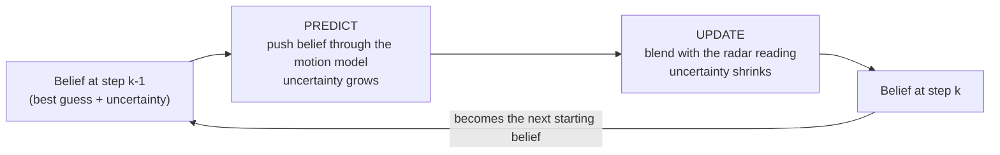
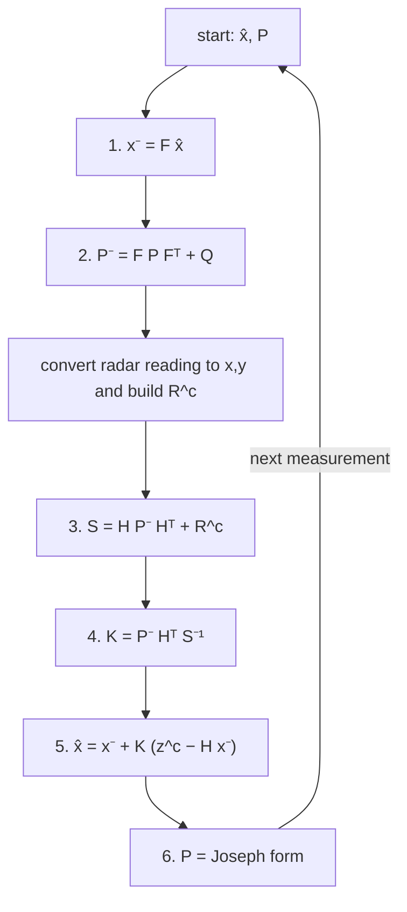
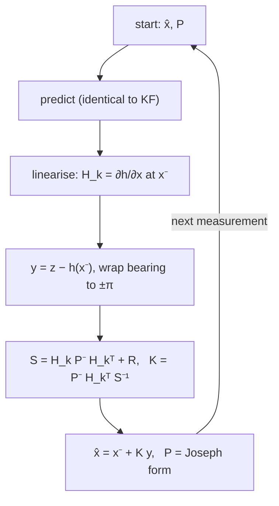
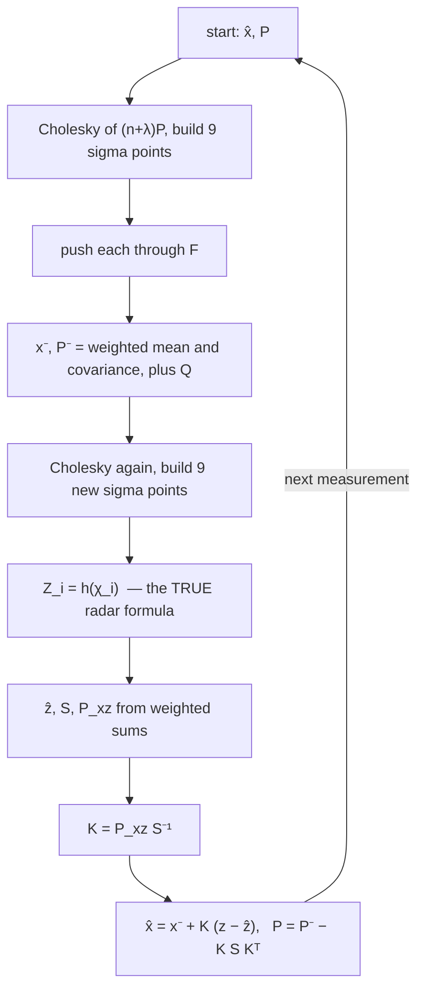
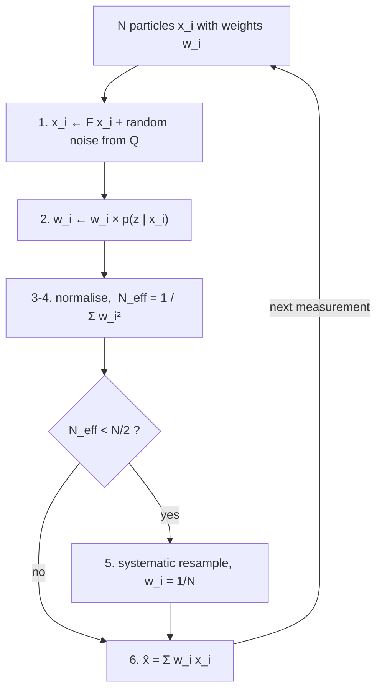
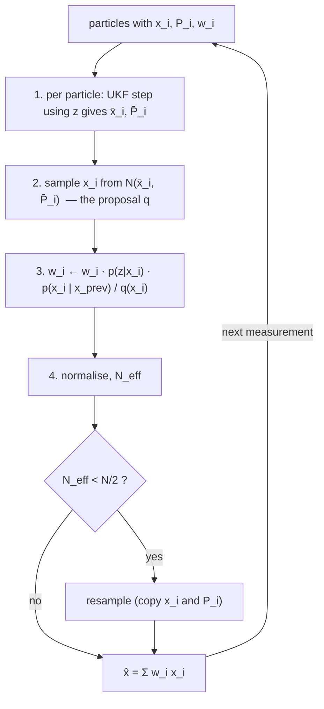
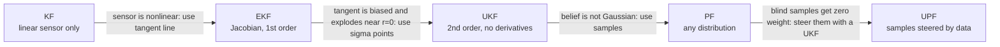

# Filters Lab: KF · EKF · UKF · PF · UPF

Five state estimators, written from scratch in **Go** (no linear-algebra libraries), served to a **React** UI, with run history in **Postgres**.

```
./up      # build + start  -> http://localhost:3000
./down    # stop
./clean   # stop + delete containers, volumes, images
```

---

## Contents

1. [The big picture](#1-the-big-picture)
2. [Symbols you will meet](#2-symbols-you-will-meet)
3. [The common model](#3-the-common-model)
4. [A 1-number example of one cycle](#4-a-1-number-example-of-one-cycle)
5. [Kalman filter (KF)](#5-kalman-filter-kf)
6. [Extended Kalman filter (EKF)](#6-extended-kalman-filter-ekf)
7. [Unscented Kalman filter (UKF)](#7-unscented-kalman-filter-ukf)
8. [Particle filter (PF)](#8-particle-filter-pf)
9. [Unscented particle filter (UPF)](#9-unscented-particle-filter-upf)
10. [How each one rescues the previous one](#10-how-each-one-rescues-the-previous-one)
11. [When the math breaks (and what the code does)](#11-when-the-math-breaks-and-what-the-code-does)
12. [Using the demo](#12-using-the-demo)
13. [Code map and API](#13-code-map-and-api)

---

## 1. The big picture

**The problem.** A radar at the origin measures a target's *distance* and *angle*. Those readings are noisy. We want the target's true position and velocity.

**The idea shared by all five filters.** Alternate two steps forever:

1. **Predict:** use physics ("it was here, moving this fast, so now it should be there") to guess where the target is. Uncertainty **grows**, because physics is imperfect.
2. **Update:** compare the guess with the radar reading and blend the two. Uncertainty **shrinks**, because we gained information.



**What differs between the filters** is only *how the belief is stored* and *how it is pushed through the nonlinear radar formula*:

| Filter | Belief is stored as | How the nonlinear radar formula is handled |
|---|---|---|
| KF | one Gaussian (mean + covariance) | not handled: needs a **linear** sensor |
| EKF | one Gaussian | replaced by a straight-line approximation (Jacobian) |
| UKF | one Gaussian | evaluated exactly at a few well-chosen points |
| PF | a cloud of many samples | evaluated exactly at every sample |
| UPF | a cloud of samples, each carrying its own Gaussian | evaluated exactly, and samples are steered toward the data |

**Reading order matters.** Each section below says what the previous filter could not do, then how this one fixes it. Section 10 summarises the whole ladder.

---

## 2. Symbols you will meet

| Symbol | Meaning | Size in this demo |
|---|---|---|
| $\mathbf{x}$ | **state**: what we want to know | 4 numbers |
| $\hat{\mathbf{x}}$ | our current **estimate** of $\mathbf{x}$ (the "mean" of the belief) | 4 numbers |
| $P$ | **covariance**: how unsure we are (diagonal = variances, off-diagonal = correlations) | 4 x 4 |
| $F$ | **motion model**: maps the old state to the predicted state | 4 x 4 |
| $Q$ | **process noise**: how wrong the motion model may be per step | 4 x 4 |
| $\mathbf{z}$ | **measurement** from the radar: range and bearing | 2 numbers |
| $h(\cdot)$ | **measurement function**: what the radar *would* read for a given state | 2 numbers out |
| $R$ | **measurement noise**: how noisy the radar is | 2 x 2 |
| $H$ | $h$ replaced by a matrix (only exact when $h$ is linear) | 2 x 4 |
| $S$ | **innovation covariance**: how surprised we expect to be by the measurement | 2 x 2 |
| $K$ | **Kalman gain**: how much to trust the measurement versus the prediction | 4 x 2 |
| $\hat{\mathbf{x}}^-$, $P^-$ | the minus sign means **after predict, before update** | |
| $N$ | number of particles | slider |
| $w^{(i)}$ | weight of particle $i$: how well it explains the data | |

Superscript $(i)$ always means "the $i$-th particle".

---

## 3. The common model

**State.** Position and velocity in 2-D:

$$\mathbf{x}_k = [\,p_x,\; p_y,\; v_x,\; v_y\,]^\top$$

**Motion model** (constant velocity plus random push):

$$\mathbf{x}_k = F\,\mathbf{x}_{k-1} + \mathbf{w}_k, \qquad \mathbf{w}_k \sim \mathcal{N}(0, Q)$$

With time step $\Delta t$, position advances by velocity times $\Delta t$ and velocity stays the same:

$$F = \begin{bmatrix} 1 & 0 & \Delta t & 0 \\ 0 & 1 & 0 & \Delta t \\ 0 & 0 & 1 & 0 \\ 0 & 0 & 0 & 1 \end{bmatrix}$$

The random push $\mathbf{w}_k$ is what lets the filter cope with the target *not* really flying in a straight line (in the demo it curves).

**Measurement model** (what a radar at the origin reports):

$$\mathbf{z}_k = h(\mathbf{x}_k) + \mathbf{v}_k, \qquad \mathbf{v}_k \sim \mathcal{N}(0, R), \qquad R = \mathrm{diag}(\sigma_r^2,\ \sigma_\theta^2)$$

$$h(\mathbf{x}) = \begin{bmatrix} \sqrt{p_x^2 + p_y^2} \\ \mathrm{atan2}(p_y,\, p_x) \end{bmatrix} = \begin{bmatrix} \text{range} \\ \text{bearing} \end{bmatrix}$$

The first row is distance from the radar, the second is the angle. **This is nonlinear** (square root, arctangent), and that single fact is the reason four of the five filters exist.

**What every filter is approximating.** The exact Bayesian cycle is:

$$\underbrace{p(\mathbf{x}_k \mid \mathbf{z}_{1:k})}_{\text{new belief}} \;\propto\; \underbrace{p(\mathbf{z}_k \mid \mathbf{x}_k)}_{\text{how well the state explains the reading}} \;\times\; \underbrace{\int p(\mathbf{x}_k \mid \mathbf{x}_{k-1})\, p(\mathbf{x}_{k-1} \mid \mathbf{z}_{1:k-1})\, d\mathbf{x}_{k-1}}_{\text{prediction}}$$

Read it as "new belief = prediction x fit-to-reading". It is impossible to compute exactly for nonlinear problems, so each filter makes a different approximation.

---

## 4. A 1-number example of one cycle

Before the 4-D version, here is the update in the simplest possible setting: one number (position), a linear sensor.

* After predict we believe position is $\hat{x}^- = 10$ with variance $P^- = 4$.
* The sensor reads $z = 12$ with noise variance $R = 1$.

$$S = P^- + R = 4 + 1 = 5 \qquad K = \frac{P^-}{S} = \frac{4}{5} = 0.8$$

$$\hat{x} = 10 + 0.8\,(12 - 10) = 11.6 \qquad P = (1 - 0.8)\cdot 4 = 0.8$$

Read it as follows. The sensor is 4x more certain than our prediction, so we move 80% of the way toward it. The new variance (0.8) is smaller than both the old one (4) and the sensor's (1): **combining information always reduces uncertainty**.

Every filter in this repo does this same blend. The 4-D version replaces numbers with vectors and matrices, and the five filters differ in how they compute $S$ and $K$ when the sensor is nonlinear.

---

## 5. Kalman filter (KF)

> **One sentence:** the exact optimal filter when motion and sensor are both linear and noise is Gaussian.

**The catch in this demo.** The radar is nonlinear, so a plain KF cannot use it directly. We feed the KF a **converted measurement**: turn (range, bearing) into Cartesian $(x, y)$ first.

$$\mathbf{z}^c = \begin{bmatrix} r\cos\theta \\ r\sin\theta \end{bmatrix}, \qquad H = \begin{bmatrix} 1 & 0 & 0 & 0 \\ 0 & 1 & 0 & 0 \end{bmatrix}$$

$H$ simply picks position out of the state. The noise has to be converted too (with $c = \cos\theta$, $s = \sin\theta$):

$$R^c = \begin{bmatrix} \sigma_r^2 c^2 + r^2\sigma_\theta^2 s^2 & (\sigma_r^2 - r^2\sigma_\theta^2)\, s c \\ (\sigma_r^2 - r^2\sigma_\theta^2)\, s c & \sigma_r^2 s^2 + r^2\sigma_\theta^2 c^2 \end{bmatrix}$$

Intuition: range error pushes the point along the line of sight, bearing error pushes it sideways, and the sideways error grows with distance $r$.

### The cycle

| Step | Equation | In words |
|---|---|---|
| 1. Predict mean | $\hat{\mathbf{x}}^- = F\hat{\mathbf{x}}$ | move the guess forward |
| 2. Predict covariance | $P^- = F P F^\top + Q$ | uncertainty grows by $Q$ |
| 3. Innovation covariance | $S = H P^- H^\top + R^c$ | expected size of surprise |
| 4. Gain | $K = P^- H^\top S^{-1}$ | trust the sensor more when $P^-$ is large or $R^c$ is small |
| 5. Update mean | $\hat{\mathbf{x}} = \hat{\mathbf{x}}^- + K(\mathbf{z}^c - H\hat{\mathbf{x}}^-)$ | correct by gain x surprise |
| 6. Update covariance | $P = (I-KH)P^-(I-KH)^\top + K R^c K^\top$ | Joseph form: stays symmetric and positive-definite |



### Shortcomings
* Only valid if the sensor really is linear. Converting polar to Cartesian is a hack: when bearing noise times distance is large, the true uncertainty is a curved **banana**, not an ellipse, so the converted Gaussian is wrong.
* Needs $S^{-1}$ (see section 11 when it does not exist).

**Fix: let the filter use the polar measurement directly. That is the EKF.**

---

## 6. Extended Kalman filter (EKF)

> **One sentence:** the KF, but the nonlinear $h$ is replaced at each step by its **tangent** (a straight-line approximation) at the current estimate.

Idea in 1-D: a curve looks like a straight line if you zoom in enough. The slope of that line is the derivative; in several dimensions the table of slopes is the **Jacobian** $H_k$:

$$H_k = \left.\frac{\partial h}{\partial \mathbf{x}}\right|_{\mathbf{x} = \hat{\mathbf{x}}^-} = \begin{bmatrix} \dfrac{p_x}{r} & \dfrac{p_y}{r} & 0 & 0 \\[8pt] -\dfrac{p_y}{r^2} & \dfrac{p_x}{r^2} & 0 & 0 \end{bmatrix}, \qquad r = \sqrt{p_x^2 + p_y^2}$$

Row 1: "if the target moves 1 m along $x$, range changes by $p_x / r$". Row 2: the same for bearing.

### The cycle

Same as the KF, with three changes:

| Step | Change versus KF |
|---|---|
| Measurement | stays in **polar** form $(r, \theta)$, no conversion |
| Innovation | $\mathbf{y} = \mathbf{z} - h(\hat{\mathbf{x}}^-)$, with the bearing difference wrapped into $(-\pi, \pi]$ |
| Matrices | $H \to H_k$ (recomputed every step) and $R^c \to R = \mathrm{diag}(\sigma_r^2, \sigma_\theta^2)$ |

Then $S = H_k P^- H_k^\top + R$, $\;K = P^- H_k^\top S^{-1}$, $\;\hat{\mathbf{x}} = \hat{\mathbf{x}}^- + K\mathbf{y}$, and the Joseph update for $P$.



### Shortcomings
* **Singular geometry.** The Jacobian has $1/r$ and $1/r^2$. When the target flies close to the radar, $r \to 0$ and $H_k \to \infty$. (The code floors $r$ at $10^{-6}$ to avoid dividing by zero, but the gain is still erratic.) The demo's flight path passes close to the radar on purpose.
* **Linearisation bias.** A tangent line ignores curvature. The filter then thinks it is more certain than it should be ("over-confident"), which can make it diverge.
* You must derive and code the Jacobian by hand.

**Fix: skip the tangent line. Evaluate the true function at carefully chosen points. That is the UKF.**

---

## 7. Unscented Kalman filter (UKF)

> **One sentence:** instead of approximating the *function*, approximate the *distribution* with a handful of **sigma points**, push those through the exact nonlinear function, and rebuild the mean and covariance from the results.

Intuition: to learn what a machine does to a Gaussian blob, don't study the machine's formula, just feed it a few representative samples and look at what comes out.

### Sigma points

For an $n = 4$ state, take $2n + 1 = 9$ points: the mean, plus one point either side of the mean along each column of a matrix square root $L$ of the covariance.

$$L L^\top = (n+\lambda)\,P \qquad (L \text{ is the Cholesky factor})$$

$$\chi_0 = \hat{\mathbf{x}}, \qquad \chi_i = \hat{\mathbf{x}} + L_{:,i}, \qquad \chi_{i+n} = \hat{\mathbf{x}} - L_{:,i}, \qquad i = 1..n$$

Each point carries weights $W^m$ (for the mean) and $W^c$ (for the covariance):

$$\lambda = \alpha^2 (n+\kappa) - n, \qquad W_0^m = \frac{\lambda}{n+\lambda}, \qquad W_0^c = W_0^m + 1 - \alpha^2 + \beta, \qquad W_i^m = W_i^c = \frac{1}{2(n+\lambda)}$$

The demo uses $\alpha = 1$, $\kappa = 1$, $\beta = 2$ (the standard choice for Gaussians).

### The cycle

**Predict** (sigma points through the motion model):

$$\chi_i^- = F\chi_i, \qquad \hat{\mathbf{x}}^- = \sum_i W_i^m \chi_i^-, \qquad P^- = Q + \sum_i W_i^c\, (\chi_i^- - \hat{\mathbf{x}}^-)(\chi_i^- - \hat{\mathbf{x}}^-)^\top$$

**Update** (draw new sigma points from $(\hat{\mathbf{x}}^-, P^-)$ and push them through the *real* radar formula):

$$\mathcal{Z}_i = h(\chi_i), \qquad \hat{\mathbf{z}} = \sum_i W_i^m \mathcal{Z}_i$$

$$S = R + \sum_i W_i^c (\mathcal{Z}_i - \hat{\mathbf{z}})(\mathcal{Z}_i - \hat{\mathbf{z}})^\top$$

$$P_{xz} = \sum_i W_i^c (\chi_i - \hat{\mathbf{x}}^-)(\mathcal{Z}_i - \hat{\mathbf{z}})^\top$$

$$K = P_{xz} S^{-1}, \qquad \hat{\mathbf{x}} = \hat{\mathbf{x}}^- + K(\mathbf{z} - \hat{\mathbf{z}}), \qquad P = P^- - K S K^\top$$

$P_{xz}$ is the **cross-covariance**: how state errors line up with measurement errors. It plays the role that $P^- H^\top$ played in the KF, but without needing $H$.

Bearing is an angle, so its mean uses a **circular mean** (average the sines and cosines, then `atan2`), otherwise points near $+\pi$ and $-\pi$ would average to roughly 0.



### Why it beats the EKF
* No Jacobian: nothing to derive, nothing that explodes at $r = 0$.
* Captures curvature: accurate to 2nd order for any nonlinearity (3rd order for Gaussian input), versus 1st order for the EKF, at the same cost.

### Shortcomings
* **Still one Gaussian.** It cannot represent a two-humped or heavy-tailed belief. One bad radar return (an outlier) drags the whole estimate.
* **Needs $P$ positive-definite** so the Cholesky factor exists. $P = P^- - KSK^\top$ is a *subtraction*, so rounding errors can make $P$ lose positive-definiteness and the Cholesky fails (section 11).

**Fix: stop assuming the belief is Gaussian. Represent it with samples. That is the particle filter.**

---

## 8. Particle filter (PF)

> **One sentence:** keep $N$ guesses ("particles"), let each one move by the motion model, then score each by how well it explains the radar reading.

Intuition: scatter 200 pins on the map, each pin is a hypothesis "the target is *here*". When a reading arrives, pins that agree with it become heavier, pins that disagree become nearly weightless. Then replace weightless pins with copies of heavy ones.

This is the **bootstrap** particle filter. Nothing is assumed Gaussian, and nothing is linearised, inverted or factorised.

### The cycle

| Step | Equation | In words |
|---|---|---|
| 1. Propagate | $\mathbf{x}_k^{(i)} = F\mathbf{x}_{k-1}^{(i)} + \mathbf{w}^{(i)}, \ \ \mathbf{w}^{(i)} \sim \mathcal{N}(0,Q)$ | every particle takes a random step |
| 2. Weigh | $w_k^{(i)} \propto w_{k-1}^{(i)}\; p(\mathbf{z}_k \mid \mathbf{x}_k^{(i)})$ | reward particles that predict the reading |
| 3. Normalise | $w^{(i)} \leftarrow w^{(i)} / \sum_j w^{(j)}$ | weights sum to 1 |
| 4. Health check | $N_{\mathrm{eff}} = 1 / \sum_i (w^{(i)})^2$ | "how many particles are really contributing?" ($N$ = perfect, 1 = disaster) |
| 5. Resample | if $N_{\mathrm{eff}} < N/2$: draw $N$ new particles in proportion to weights, reset weights to $1/N$ | clone winners, drop losers (systematic resampling) |
| 6. Estimate | $\hat{\mathbf{x}} = \sum_i w^{(i)} \mathbf{x}^{(i)}$ | weighted average |

**The likelihood** in step 2 is a two-part mixture. It says "the radar is usually accurate, but with probability $\epsilon$ it returns garbage with 8x larger noise":

$$p(\mathbf{z} \mid \mathbf{x}) = (1-\epsilon)\,\mathcal{N}\big(\mathbf{z};\, h(\mathbf{x}),\, R\big) + \epsilon\,\mathcal{N}\big(\mathbf{z};\, h(\mathbf{x}),\, 64R\big)$$

Because of the wide second component, an outlier lowers every particle's weight by a similar amount instead of destroying the estimate. This is something the KF family cannot express.



### Why it beats the UKF
* Any shape of belief (multimodal, skewed, heavy-tailed).
* Exact nonlinearity, no Jacobians, no $P$, no matrix inverse, no Cholesky of $P$. Nothing here can be "singular".

### Shortcomings
* **Blind proposal.** Particles move *before* looking at the reading. If the sensor is very precise, the likelihood is a thin spike, almost no particle lands inside it, nearly all weights are about 0 and $N_{\mathrm{eff}}$ collapses toward 1. This is **weight degeneracy**.
* **Impoverishment.** Resampling copies the few survivors. With little process noise the copies never spread out again.
* Cost and noise grow with $N$; the estimate is random (changes with the seed).

**Fix: don't move particles blindly. Let each particle look at the reading first. That is the UPF.**

---

## 9. Unscented particle filter (UPF)

> **One sentence:** run a small **UKF inside every particle** so each particle moves *toward the measurement*, then correct the weights for having cheated.

Intuition: in the PF, particles wander randomly and hope some land near the truth. In the UPF, each particle first asks its own UKF "given this new reading, where should I be?" and then samples *around that answer*. Far more particles land in useful places, so far fewer are needed.

### The cycle (for each particle $i$)

1. **Look at the data:** run a UKF step (section 7) from $(\mathbf{x}_{k-1}^{(i)},\, P_{k-1}^{(i)})$ with the new $\mathbf{z}_k$. It returns a mean and covariance $(\bar{\mathbf{x}}_k^{(i)},\, \bar{P}_k^{(i)})$.
2. **Sample from that:** draw $\mathbf{x}_k^{(i)} \sim q = \mathcal{N}(\bar{\mathbf{x}}_k^{(i)},\, \bar{P}_k^{(i)})$. Here $q$ is called the **proposal**.
3. **Fix the bias:** sampling from $q$ instead of from the motion model skews the cloud, so correct with an **importance weight**:

$$w_k^{(i)} \;\propto\; w_{k-1}^{(i)} \;\frac{p(\mathbf{z}_k \mid \mathbf{x}_k^{(i)})\;\; p(\mathbf{x}_k^{(i)} \mid \mathbf{x}_{k-1}^{(i)})}{q(\mathbf{x}_k^{(i)} \mid \mathbf{x}_{k-1}^{(i)}, \mathbf{z}_k)}$$

Read it as: *(how well it fits the reading)* x *(how plausible the move was under physics)* divided by *(how much we favoured that move when sampling)*.

4. Normalise, compute $N_{\mathrm{eff}}$, resample if needed (copying each particle's $\bar{P}^{(i)}$ along with it), estimate as in the PF.



### What it combines
* From the **UKF**: the data-aware, nonlinear proposal (cures PF degeneracy).
* From the **PF**: the final weighting and resampling still give a non-Gaussian, outlier-robust posterior (cures the UKF's single-Gaussian limit). In this demo the proposal is Gaussian, but the weight uses the outlier mixture likelihood, so outliers are still down-weighted.

### Shortcomings
* The slowest filter: $N$ UKFs per step.
* Inherits the UKF's need for positive-definite covariances (handled by jitter, section 11).

---

## 10. How each one rescues the previous one



| Problem | Who suffers | Who fixes it, and how |
|---|---|---|
| Nonlinear radar formula | **KF** (only works on converted, approximate measurements) | **EKF**: linearise $h$ directly |
| Target near radar: $H$ has $1/r$ terms that blow up; tangent line is biased; $P$ over-confident | **EKF** | **UKF**: evaluate $h$ at sigma points, no derivative |
| $S = H P H^\top + R$ **cannot be inverted** | **KF, EKF, UKF**: gain $K$ undefined | All three use a regularised inverse ($S + \lambda I$). **PF** and **UPF** weigh by likelihood and never invert $S$ in the weights. |
| $P$ not positive-definite, **Cholesky fails** | **UKF** (and the UKF inside the UPF) | Jitter fallback; Joseph form where used. **PF** has no $P$ to factor. |
| Outliers, heavy tails, multi-modal belief | **KF, EKF, UKF**: a single Gaussian gets dragged | **PF**: mixture likelihood |
| Sharp sensor, so weights collapse ($N_{\mathrm{eff}} \to 1$) | **PF** | **UPF**: proposal already near the data |
| Need thousands of particles | **PF** | **UPF** gets by with far fewer |

**Rule of thumb for choosing:**

| Situation | Pick |
|---|---|
| Linear sensor, Gaussian noise | KF (optimal, cheapest) |
| Mildly nonlinear, you can write the Jacobian | EKF |
| Strongly nonlinear, or Jacobian awkward | UKF |
| Outliers, multimodal belief, non-Gaussian noise | PF |
| Same, but the sensor is precise or accuracy matters most | UPF |

---

## 11. When the math breaks (and what the code does)

The checkbox **Break the math** sets $R = 0$, $Q = 0$, $P_0 = 0$ (a perfect sensor, a perfect motion model, and a perfectly known start). This is mathematically degenerate and exposes every numerical safety net. The scoreboard shows how many times each one fired.

| Event shown in UI | What went wrong | What the code does |
|---|---|---|
| `singular_S_regularised` | $S = HPH^\top + R$ has no inverse (for example $P = 0$ and $R = 0$ gives $S = 0$). The gain $K = P H^\top S^{-1}$ is then undefined. | Try the exact inverse (Gauss-Jordan with pivoting). If a pivot is tiny, retry with **Tikhonov regularisation** $(S + \lambda I)^{-1}$, multiplying $\lambda$ by 10 from $10^{-9}$ until it works. |
| `not_PSD_jitter_added` | A covariance is not positive-definite (zero or slightly negative eigenvalue from rounding), so the Cholesky factor needed for sigma points or sampling does not exist. | Symmetrise $P \leftarrow (P + P^\top)/2$, then add growing diagonal jitter until Cholesky succeeds. |
| `weight_collapse_reset` | Every particle weight underflowed to 0 (sensor too sharp for the blind PF). | Reset to uniform weights and continue. |
| `resampled` (blue, informational) | $N_{\mathrm{eff}}$ fell below $N/2$. Not an error. | Systematic resampling. |

**Expected result with Break the math on.** With $P = 0$ and $Q = 0$ the KF-family filters believe they are *perfect*, so $K = 0$ and they ignore the radar and stay at their (wrong) prior. This is not a bug; it is the lesson: **$P_0 \succ 0$ and $Q \succ 0$ are not optional**. A filter that is 100% sure learns nothing. The particle filters keep working because they compare samples against the data rather than relying on $P$.

---

## 12. Using the demo

**Reading the track plot**

| Mark | Meaning |
|---|---|
| white dashed line | true path (the filters never see this) |
| grey dots | raw radar returns, converted to x,y for display |
| coloured line + dot | each filter's estimate |
| coloured ring around the dot | that filter's own 1-sigma position uncertainty (a *confident but wrong* filter has a tiny ring far from the white line) |
| coloured cloud | PF / UPF particles (100 shown) |

Use the slider under the plot to scrub through time and the play button to animate it. The chart below shows position error per step; the table gives RMSE (root-mean-square error, lower is better), run time and numerical events.

**Experiments, in order**

1. **Defaults.** Run all five. KF, EKF, UKF are close; watch what happens near the radar (the closest approach), where the EKF is the most likely to wobble.
2. **Raise "Outlier probability" to 0.15-0.30.** The grey dots now include wild returns. KF/EKF/UKF get yanked sideways; PF and UPF shrug them off (mixture likelihood).
3. **Lower range and bearing noise toward 0** (with outliers at 0). Watch the PF's "Neff now" in the scoreboard fall and its `weight_collapse_reset` count rise, while the UPF stays healthy. Also try reducing particles to 20-50 to see the UPF's advantage.
4. **Raise bearing noise to 8-10 degrees.** Large angular error makes the uncertainty banana-shaped, which hurts the KF (converted-measurement trick) most.
5. **Tick "Break the math".** See section 11.
6. **Change the seed.** The same settings with another random draw show how much of any result is luck; compare several seeds before declaring a winner.

Every run is saved to Postgres; click an entry under "Saved runs" to reload it exactly.

---

## 13. Code map and API

| Part | File | Notes |
|---|---|---|
| Matrix maths | `backend/mat.go` | multiply, transpose, Gauss-Jordan inverse, Cholesky, `SafeInv`, `SafeChol`, Gaussian log-density |
| Filters | `backend/filters.go` | `KF`, `EKF`, `UKF` (`ukfStep`), `PF` (one struct; flag `upf` switches the bootstrap proposal to the UKF proposal) |
| Simulation | `backend/sim.go` | curving fly-by truth, noisy radar with outliers, RMSE and timing |
| Server + DB | `backend/main.go` | HTTP API, table `runs` (JSONB), works without Postgres |
| UI | `frontend/src/App.jsx` | canvas track, particle clouds, error chart, scoreboard, run history |

```
POST /api/run         {steps, dt, sigmaR, sigmaThetaDeg, q, outlier, particles, turn, seed, breakMath, filters:["kf","ekf","ukf","pf","upf"]}
GET  /api/runs        last 20 saved runs (summary)
GET  /api/runs/{id}   one full saved result
GET  /api/health      {ok, db}
```

Services (docker compose): `db` (Postgres 16), `api` (Go, port 8080 internal), `web` (nginx serving the React build and proxying `/api`, published on port 3000).
